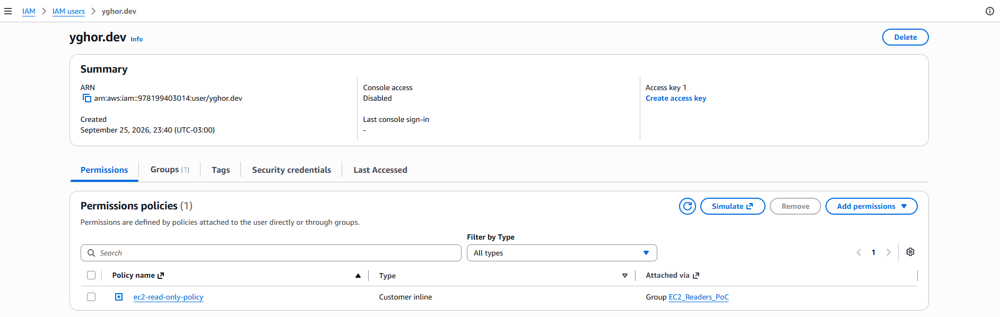
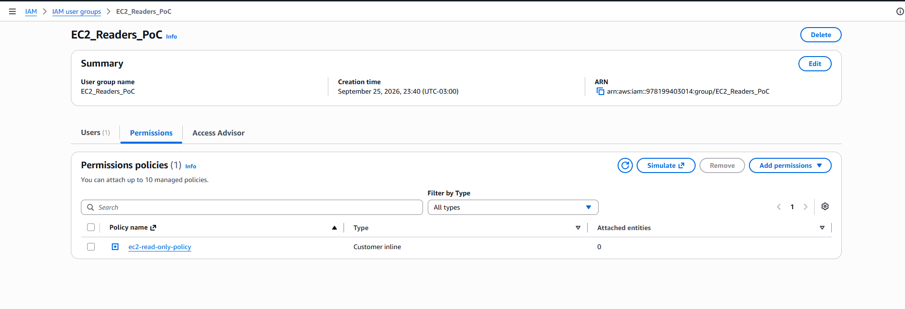
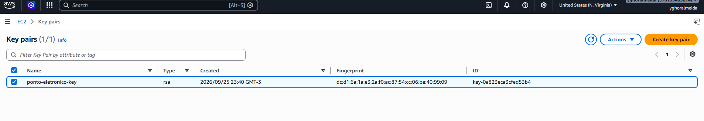
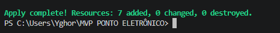

# PoC - Task CLD-102: Governança IAM e Gestão de Key Pairs

## 📌 Contexto
Este documento detalha a Prova de Conceito (PoC) da task **CLD-102** do PROJETO MVP PONTO ELETRÔNICO. O objetivo desta etapa foi provisionar, de forma automatizada e segura, a governança de acessos (IAM) e a gestão de chaves SSH utilizando **Terraform**.

## 🚀 O que foi implementado

A infraestrutura foi dividida em duas frentes principais:

### 1. Gestão de Key Pairs SSH
Para garantir o acesso seguro às instâncias EC2 que serão provisionadas nas próximas tasks, automatizamos a criação e gestão das chaves:
* **Geração de Chave RSA:** Criação de uma chave privada local via Terraform (Provider `tls`).
* **Deploy na AWS:** Envio automático da chave pública para a AWS, registrando o Key Pair como `ponto-eletronico-key` na região `us-east-1`.
* **Segurança Local:** Salvamento automático da chave privada (`ponto-eletronico-key.pem`) no ambiente local com permissões estritas de leitura (`0400`), seguindo as melhores práticas de segurança para acesso SSH.

### 2. Governança de IAM (Least Privilege)
Aplicamos o princípio do **menor privilégio** para garantir que os acessos sejam restritos apenas ao necessário:
* **Usuário IAM:** Criação do usuário de desenvolvimento `yghor.dev`.
* **Grupo Lógico:** Criação do grupo `EC2_Readers_PoC` para facilitar a escalabilidade na gestão de permissões da equipe.
* **Política Restritiva:** Criação de uma política inline que permite **apenas leitura** de recursos do EC2 (`DescribeInstances`, `DescribeTags`, `DescribeVolumes`, `DescribeKeyPairs`). O usuário não possui permissão para criar, modificar ou destruir recursos.
* **Associação:** O usuário foi automaticamente adicionado ao grupo via código.

## 🛠️ Tecnologias Utilizadas
* **Terraform:** Para orquestração da infraestrutura como código (IaC).
* **AWS CLI:** Para autenticação e comunicação com a nuvem.
* **Providers Terraform:** `hashicorp/aws`, `hashicorp/tls`, `hashicorp/local`.

## ✅ Como validar
Os recursos foram provisionados na região **US East (N. Virginia) [us-east-1]**.
1. No console da AWS, acesse o painel do **IAM** para visualizar o usuário `yghor.dev` e o grupo `EC2_Readers_PoC` com suas respectivas permissões.
2. Acesse o painel do **EC2 > Key Pairs** para verificar a chave `ponto-eletronico-key`.

## ✅ Evidências de Validação (Console AWS)

**1. Usuário IAM criado com sucesso:**

**2. Grupo IAM e Política de Menor Privilégio:**

**3. Key Pair gerada na região us-east-1:**

**4. Execução do Terraform no Terminal:**
